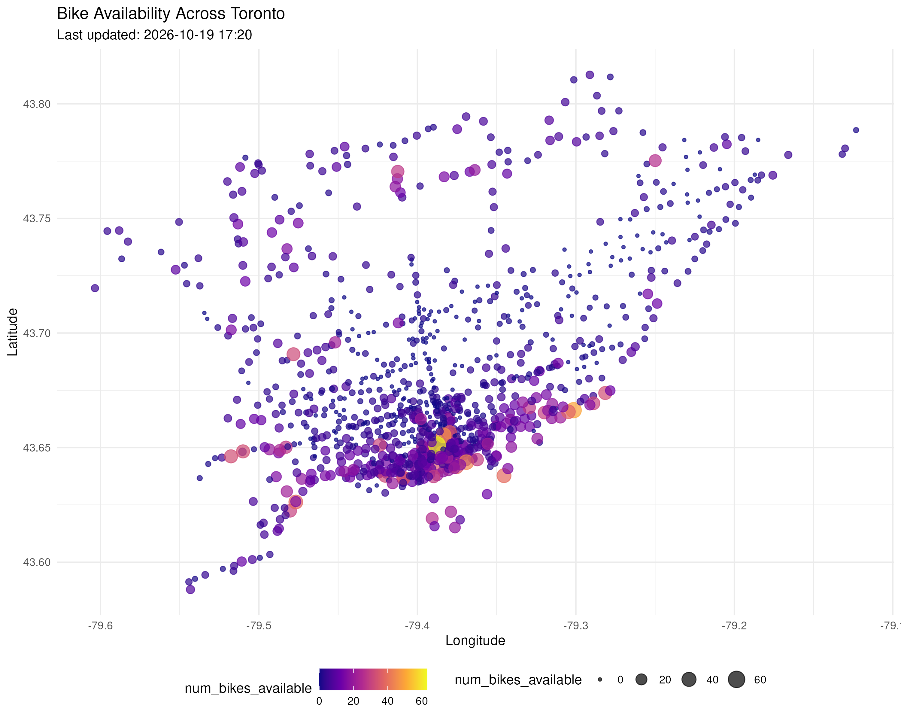
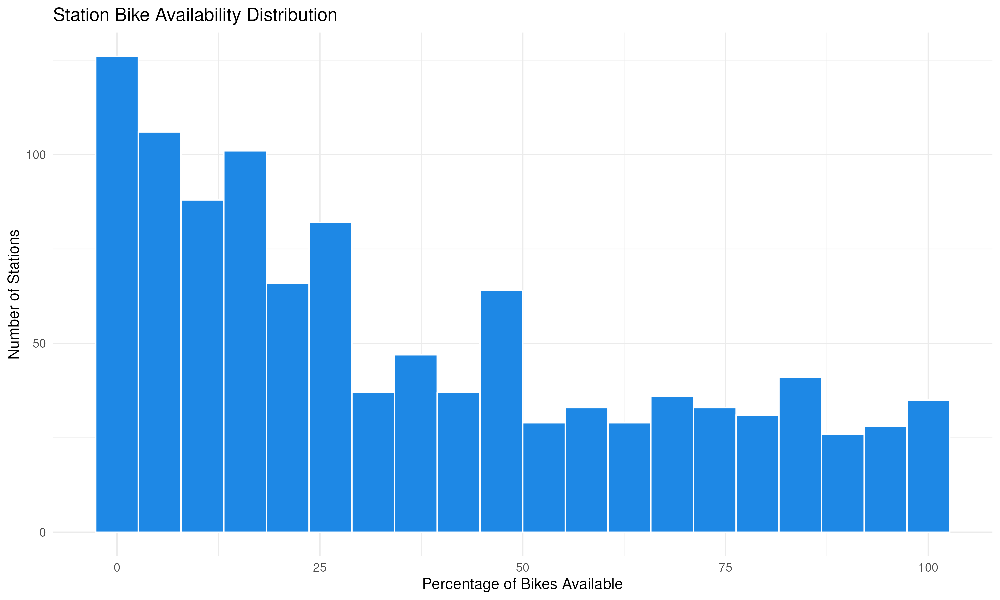
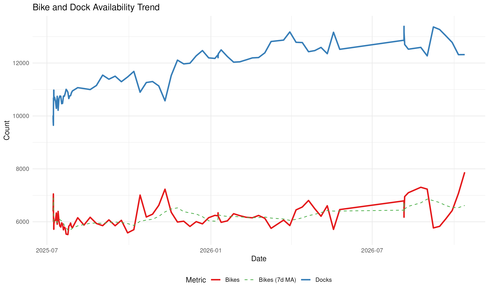
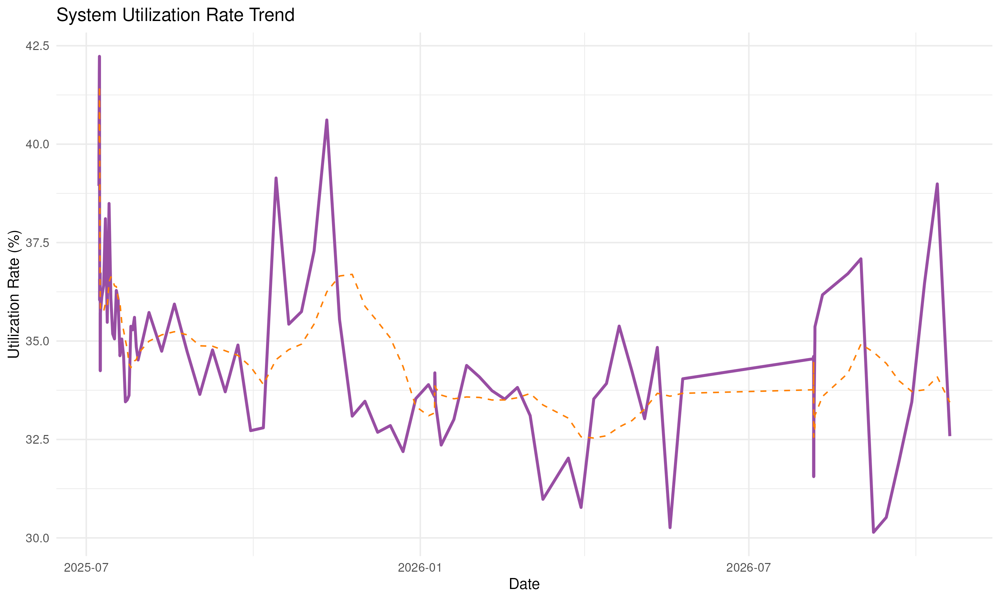

# 🚲 Toronto Bike Share Analytics

Updated: 2026-10-26 17:16 (Toronto Time)

## 🖥️ Live Dashboard
View the interactive dashboard with the full history of bike availability: [https://bryanpaget.github.io/toronto-bikeshare/](https://bryanpaget.github.io/toronto-bikeshare/)

## 📊 System Overview
| Metric | Value | Change |
|--------|-------|--------|
| **Total bikes available** | 6,852 | +555 |
| **Total docks available** | 12,820 | -208 |
| **System utilization rate** | 34.8% | +2.2% |
| **Active stations** | 1071/1071 (100%) | +2 |
| **Average bikes per station** | 6.4 | +1 |
| **Median station capacity** | 17 | - |
| **Empty stations** | 199 (18.6%) | -4 |
| **Full stations** | 34 (3.2%) | +20 |

## 🏆 Top 10 Stations by Bike Availability
| Station | Bikes Available | Capacity |
|---------|-----------------|----------|
| Toronto Inukshuk Park | 79 | 87 |
| Bay St / Albert St | 54 | 63 |
| Humber Bay Shores Park / Marine Parade Dr | 46 | 63 |
| Front St W / Yonge St (Hockey Hall of Fame) | 45 | 47 |
| Kewbeach Ave / Kenilworth Ave | 44 | 61 |
| Queen St E / Woodward Ave | 43 | 43 |
| Alton Ave / Dundas St E (Greenwood Park) | 41 | 42 |
| Woodbine Ave / Lake Shore Blvd E | 39 | 43 |
| 2700 Eglinton Ave W | 39 | 43 |
| Temperance St Station | 38 | 55 |

## 🏆 Top 10 Stations by Dock Availability
| Station | Docks Available | Capacity |
|---------|-----------------|----------|
| Simcoe St / Pullan Pl | 58 | 79 |
| Queen St W / Ossington Ave | 41 | 43 |
| Bloor St W / Manning Ave - SMART | 40 | 42 |
| Bathurst St / Dundas St W | 39 | 41 |
| Fort York  Blvd / Capreol Ct | 37 | 47 |
| Niagara St / Richmond St W | 35 | 42 |
| Frederick St / King St E | 35 | 47 |
| Yonge St / Orchard View Blvd | 34 | 35 |
| 439 Sherbourne St | 34 | 47 |
| University Ave / Elm St | 33 | 35 |

## 📊 Station Status Distribution
| Status     | Number of Stations |
|------------|-------------------:|
| Empty      | 199 |
| Full       | 33 |
| Available  | 839 |

## 📍 Bike Locations

## 📈 Bike Availability Distribution

## 📈 Historical Trends
### Bike and Dock Availability

### System Utilization Rate

## 📊 Sampling Methodology
The data is collected from the Toronto Bike Share GBFS API at a single point in time. This provides a snapshot of the system but may not capture temporal variations.

### Key Metrics Explained
1. **Utilization Rate**: The proportion of total bike slots that are occupied by bikes:
   $$\text{Utilization Rate} = \frac{\text{Total Bikes}}{\text{Total Bikes} + \text{Total Docks}} \times 100\%$$

2. **Station Status Classification**:
   - **Empty**: $\text{bikes} = 0$
   - **Full**: $\text{docks} = 0$
   - **Available**: $\text{bikes} > 0$ and $\text{docks} > 0$

### Statistical Notes
- The distribution of bikes across stations follows a right-skewed distribution
- The mean availability is 30.1% with a standard deviation of 29.2%
- The system is currently operating at 35% capacity

## ℹ️ Data Source
Data is sourced from the [Toronto Bike Share GBFS API](https://tor.publicbikesystem.net/ube/gbfs/v1/en/station_status)

## 🚴 About Bike Share Toronto
Bike Share Toronto is the city's public bike share system, owned and operated by the Toronto Parking Authority. It launched in May 2011 as Bixi Toronto with about 1,000 bikes and 80 stations, and was rebranded as Bike Share Toronto when the Toronto Parking Authority took over operations in 2014. Today it has grown to more than 1,000 stations and 10,000+ bikes (including roughly 2,100 electric bikes) across the city.

The system has expanded rapidly alongside the city's cycling network. Annual ridership grew from about 2.9 million trips in 2020 to 5.7 million in 2023, 7.0 million in 2024, and a record 7.8 million trips in 2025 — with continued growth expected in 2026 as more e-bikes, charging docks, and stations are added.

The city's 2030 Growth Strategy (Ride More, Connect More) lays out a roadmap for roughly doubling the network, integrating bike share more closely with transit, and expanding into underserved neighbourhoods. Equity programs such as the Reduced Fare Pass make the system more affordable, and expansion priorities are informed by research on how to make bike share reach more residents in lower-income areas.

- Official site: [bikesharetoronto.com](https://bikesharetoronto.com/)
- Overview & history: [Wikipedia - Bike Share Toronto](https://en.wikipedia.org/wiki/Bike_Share_Toronto)
- City of Toronto: [Toronto Parking Authority - 2030 Growth Strategy (PDF)](https://www.toronto.ca/legdocs/mmis/2025/pa/bgrd/backgroundfile-260875.pdf)

## 🚲 Bike Share Across Canada and the World
Toronto is part of a growing network of public bike share systems. Montreal's BIXI (2009) was the first modern public bike share in North America, and other major Canadian systems include Vancouver's Mobi by Shaw Go (2016) and Hamilton's bike share (2015). Internationally, the well-known systems include Paris' Vélib', London's Santander Cycles, New York's Citi Bike, and Washington D.C.'s Capital Bikeshare. Hundreds of cities worldwide now operate docked or dockless bike share programs as part of their urban mobility toolkit.

## 🌍 Why Bike Share Matters for Cities
Bike share systems deliver a broad set of benefits for cities and their residents:
1. **First- and last-mile connections**: Bike share fills the gap between transit stops (GO, TTC,    and regional rail) and people's homes, workplaces, and errands, extending the reach of public    transit without large capital investment.
2. **Less congestion**: Short car trips can be replaced by bikes, easing road congestion. Research    on Washington D.C.'s Capital Bikeshare estimated it reduced neighbourhood-level traffic    congestion by up to 4% (Hamilton & Wichman, 2018).
3. **Health benefits**: Bike share encourages everyday physical activity. A study of European    bike share systems estimated that, if all bike share trips replaced car trips, up to 73    deaths could be prevented each year across those cities — and benefits outweigh risks in    every scenario considered (Otero, Nieuwenhuijsen & Rojas-Rueda, 2018).
4. **Lower emissions**: Replacing car trips reduces greenhouse gas emissions and local air    pollution, supporting municipal climate and Vision Zero goals.
5. **Equitable, affordable mobility**: At low cost, bike share provides flexible mobility to    residents who may not own a bike or a car, and targeted pricing and station placement can    address transportation inequity in lower-income neighbourhoods (see TMU research below).
6. **Efficient use of public space**: A single bike lane or docked station moves many more    people per hour than the equivalent car parking, making better use of valuable street space.

## 📚 Research & Further Reading
- **Health impacts of bike share** — Otero, I., Nieuwenhuijsen, M.J. & Rojas-Rueda, D. (2018).   *Health impacts of bike sharing systems in Europe*. Environment International, 115, 387-394.   [https://doi.org/10.1016/j.envint.2018.04.014](https://doi.org/10.1016/j.envint.2018.04.014)
- **Congestion reduction** — Hamilton, T.L. & Wichman, C.J. (2018). *Bicycle infrastructure and   traffic congestion: Evidence from DC's Capital Bikeshare*. Journal of Environmental Economics   and Management, 87, 72-93. [https://doi.org/10.1016/j.jeem.2017.03.007](https://doi.org/10.1016/j.jeem.2017.03.007)
- **Review of the bike share literature** — Fishman, E., Washington, S. & Haworth, N. (2013).   *Bike Share: A Synthesis of the Literature*. Transport Reviews, 33(2), 148-165.   [https://doi.org/10.1080/01441647.2013.775612](https://doi.org/10.1080/01441647.2013.775612)
- **Equity in Toronto's bike share** — Mekonnen, S. (2022). *A Plan for an Equitable Expansion of   Bike Share Toronto* (Toronto Metropolitan University).   [https://doi.org/10.32920/17329601](https://doi.org/10.32920/17329601)

## 🤝 Canadian Cycling & Urban Associations
- **Vélo Canada Bikes** — Canada's national cycling advocacy organization.   [https://velocanadabikes.org](https://velocanadabikes.org/)
- **Cycle Toronto** — Toronto's member-supported cycling advocacy charity, promotes safe cycling   across the city. [https://www.cycleto.ca](https://www.cycleto.ca/)
- **Share the Road Cycling Coalition** — Ontario-wide coalition working with municipalities on   cycling infrastructure and policy. [https://sharetheroad.ca](https://sharetheroad.ca/)
- **Transportation Association of Canada (TAC)** — National association producing guides and   standards for sustainable transportation and active mobility.   [https://www.tac-atc.ca](https://www.tac-atc.ca/en)
- **City of Toronto - Cycling** — City cycling network, maps, and programs.   [https://www.toronto.ca/cycling](https://www.toronto.ca/services-payments/streets-parking-transportation/cycling-in-toronto/)
- **Toronto Metropolitan University - School of Urban & Regional Planning / City Building** —   Research on urban mobility, transit, and city planning.   [https://www.torontomu.ca/city-building](https://www.torontomu.ca/city-building/)

## 📊 Predictive Analytics

Based on upcoming events and historical patterns, here are the predicted changes in bike demand:

### 📈 High Demand Predictions (Add Bikes)
| Station | Predicted Increase | Event Impact | Associated Event |
|---------|-------------------|--------------|------------------|
| Simcoe St / Pullan Pl | +20% | Outdoor Activity | Eric Bauza, Toronto-born voice of Bugs Bunny and Daffy Duck, dies at 46 |
| Bay St / Albert St | +20% | Sports Event | Eric Bauza, Toronto-born voice of Bugs Bunny and Daffy Duck, dies at 46 |
| Humber Bay Shores Park / Marine Parade Dr | +18% | Food Festival | General prediction |
| Toronto Inukshuk Park | +15% | Art/Cultural Event | Eric Bauza, Toronto-born voice of Bugs Bunny and Daffy Duck, dies at 46 |

### 📉 No Low Demand Predictions
No stations are predicted to have significantly decreased demand based on upcoming events.

### 📅 Upcoming Events Influencing Predictions
| Event | Date | Description | Recommended Action |
|-------|------|-------------|-------------------|
| [Eric Bauza, Toronto-born voice of Bugs Bunny and Daffy Duck, dies at 46](https://www.narcity.com/toronto/eric-bauza-toronto-born-voice-of-bugs-bunny-dies-at-46) | 2026-10-27 | Eric Bauza, the Toronto-born voice actor who br... | Increase bikes nearby |
| [Man, 35, arrested in second-degree murder in Mississauga, Ont., homicide: police](https://www.narcity.com/toronto/police-id-suspect-in-mississauga-ont-homicide) | 2026-10-27 | Peel police say they have arrested and charged ... | Increase bikes nearby |
| [Toronto votes in tight mayoral race as Chow looks to hold off Bradford](https://www.narcity.com/toronto/toronto-votes-in-tightly-contested-mayoral-race) | 2026-10-27 | The next leader of Toronto is set to be decided... | Increase bikes nearby |
| [This $20 train from Toronto takes you to a riverside town with little cafes and quaint shops](https://www.narcity.com/toronto/via-rail-toronto-port-hope-tickets-things-to-do) | 2026-10-26 | You don't need a car to travel to a charming sm... | Increase bikes nearby |
| [Spooky Halloween nail ideas to try this year](https://viewthevibe.com/spooky-halloween-nail-ideas-to-try-this-year/) | 2026-10-27 | Looking for Halloween nail inspo? You’ve come t... | Monitor usage |
| [Halloween makeup essentials: What you need for a killer look](https://viewthevibe.com/halloween-makeup-essentials-what-you-need-for-a-killer-look/) | 2026-10-27 | Ready to bring your Halloween costume to life? ... | Monitor usage |
| [Toronto temperatures are going to swing by nearly 20 C this week](https://www.blogto.com/city/2026/10/toronto-temperatures-swing-nearly-20-c/) | 2026-10-27 | The lead-up to Halloween has been relatively mi... | Increase bikes nearby |
| [DJ John Summit just brunched at an unlikely Toronto restaurant](https://www.blogto.com/eat_drink/2026/10/john-summit-toronto-restaurant/) | 2026-10-27 | American DJ John Summit may have spent a sold-o... | Increase bikes nearby |
| [Here's how this Toronto vendor market feels about the Phoenix Concert Theatre moving in](https://www.blogto.com/fashion_style/2026/10/phoenix-concert-hall-sunday-variety-market/) | 2026-10-27 | When news broke that Toronto Phoenix Concert Th... | Increase bikes nearby |
| [Canada's biggest and oldest art fair comes Toronto this week](https://www.blogto.com/arts/2026/10/art-toronto-2026/) | 2026-10-27 | Canada's largest and oldest international art f... | Increase bikes nearby |

*Last updated: 2026-10-26 21:18 (Toronto Time)*
*Model confidence: Based on historical patterns and upcoming events from multiple RSS feeds (Narcity Toronto, View The Vibe, YYZ Deals).*
*Events analyzed: Eric Bauza, Toronto-born voice of Bugs Bunny and Daffy Duck, dies at 46, Man, 35, arrested in second-degree murder in Mississauga, Ont., homicide: police, Toronto votes in tight mayoral race as Chow looks to hold off Bradford.... Stations near events receive adjusted predictions.*

